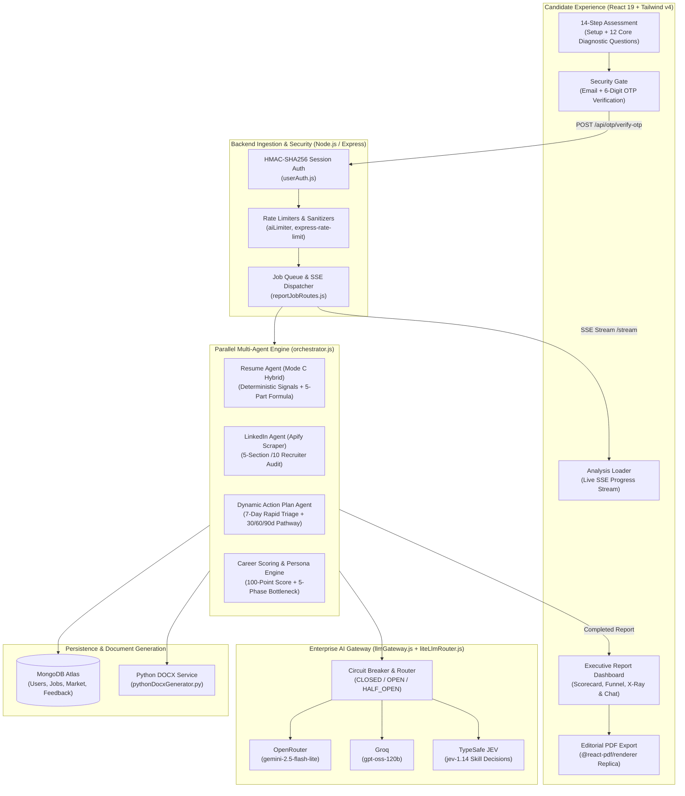

# Crafture Career GPS V2 — AI-Powered Career Health & Recruiter Intelligence Platform

**Crafture Career GPS V2** is an enterprise-grade career diagnostic and recruiter intelligence platform that evaluates tech candidates across the entire hiring lifecycle — ATS resume optimization, LinkedIn recruiter visibility, application funnel conversion, interview clearance velocity, and market positioning.

Built on **React 19, Vite 8, Tailwind CSS v4, and Node.js/Express**, Career GPS combines a conversational, gamified candidate assessment with a deterministic multi-agent intelligence pipeline powered by a resilient, multi-provider **AI Gateway** (OpenRouter, Groq, Gemini, and TypeSafe JEV).

---

## 🧭 System Overview



---

## ⚡ Key Highlights & Capabilities

### 1. Dual-Layer Assessment Architecture
- **Layer 1 (Candidate UX)**: Friendly, curiosity-driven 14-step onboarding featuring custom 3D Wobnimo mascot interactions, live application volume toggles (`Weekly` vs `Monthly`), contextual helpers, and auto-parsing.
- **Layer 2 (AI Semantic Profile)**: Every response maps to a strictly typed, machine-readable `SEMANTIC_REGISTRY` entry detailing `semanticKey`, `questionIntent`, `unit`, `timeframe`, and normalized 90-day application funnel metrics.

### 2. Resume Specialist Agent (Mode C Hybrid)
- **Deterministic Pre-Processing**: Parses resumes into canonical JSON with stable IDs (`exp_001_b01`, `proj_001_b01`), extracting deterministic signals (`BulletSignals`, `ContactMergeSignal`, `QuantificationRollup`) before making any LLM calls.
- **5-Part Executive Formula**: Fallback bullet rewrites strictly follow: `[Action Verb] + [Core Task/Scope] + [Stakeholders/Method] + [Dynamic Operational Metric] + [Strategic Business ROI]`.
- **Domain-Matched Outcomes**: Automatically detects bullet domains (QA, Frontend, Backend, DevOps, Security) to rotate contextually accurate metrics and eliminate canned suffixes.
- **Deterministic Rubric Ceilings**: Enforces hard score ceilings in `resumeScorecard.js` (e.g. 0 quantified bullets caps Experience score at $\le 5/10$ with `status: 'warn'`).

### 3. LinkedIn Recruiter Visibility Agent
- **Apify Integration**: Scrapes public LinkedIn profiles with concurrency deduplication.
- **5-Section Recruiter Rubric**: Evaluates Headline, About/Summary, Experience Alignment, Skills & Endorsements, and Activity/Thought Leadership on a standardized 10-point scale.
- **Executive Headline Studio**: Generates 3 strategic headline options (Role Specialist, High-Growth Operator, Technical Architect).

### 4. Dynamic Action Plan & Ask Atlas Chatbot
- **Tailored 7-Day Sprint**: Generates customized daily actions addressing candidate-specific drop-off gates. High-volume, low-callback profiles ($100+$ apps, $\le 1.0\%$ callback) receive automatic referral volume caps ($15$/week).
- **Ask Atlas Chatbot**: Grounded in a compressed ~1,200 token Pocket Context Dossier with 3-tier provider failover (`gemini-2.5-flash-lite` $\rightarrow$ `groq/gpt-oss-120b` $\rightarrow$ `deepseek-chat`).

### 5. Multi-Provider AI Gateway & Circuit Breaker
- **Zero Hardcoded Provider Lock-in**: All agent LLM requests flow through `llmGateway.generate()`.
- **Circuit Breaker (`liteLlmRouter.js`)**: Real-time tracking of provider health states (`CLOSED`, `OPEN`, `HALF_OPEN`) with canary recovery, 45-second cooldowns, and automatic failover across OpenRouter, Groq, and Gemini.
- **Trap Model Protection**: Filters out deprecated or quota-choked models (`gemini-2.5-flash`, `gemini-1.5-pro`) to ensure $100\%$ delivery uptime.

### 6. Client-Side Editorial PDF Generation
- **`@react-pdf/renderer` Engine**: Pure client-side generation in `CareerReportPdf.jsx` featuring continuous page flow, full-bleed unslop editorial banners, and strict rubric ceilings.

---

## 🛠️ Tech Stack

| Domain | Technologies |
| :--- | :--- |
| **Frontend** | React 19, Vite 8, Tailwind CSS v4, Zustand (`useAppStore.js`), Recharts, `@react-pdf/renderer`, Framer Motion, Lucide Icons, Wobnimo 3D Mascot |
| **Backend** | Node.js (v20+ ESM), Express, MongoDB (Mongoose 8+), Apify Client, `pdf-parse`, `mammoth`, Python DOCX Generator (`python-docx`) |
| **AI Gateway** | Custom `LLMGateway` + `liteLlmRouter.js` Circuit Breaker, OpenRouter, Groq, Google Gemini API, TypeSafe JEV (`typesafe/jev-1.14`) |
| **Security & Auth** | HMAC-SHA256 `sessionToken` (`userAuth.js`), JWT Admin Auth (`adminAuth.js`), `express-rate-limit`, NoSQL Injection Sanitization |

---

## 🚀 Local Setup & Installation

### Prerequisites
- **Node.js**: `v20.x` or higher
- **MongoDB**: Local MongoDB instance or MongoDB Atlas URI
- **Python**: `3.10+` with `python-docx` installed (for ATS resume DOCX export)
- **API Keys**: At least one LLM key (`OPENROUTER_API_KEY`, `GROQ_API_KEY`, or `GEMINI_API_KEY`)

### 1. Clone the Repository
```bash
git clone https://github.com/Aditya-2629/carrer-gps-asessment.git
cd carrer-gps-asessment
git checkout v2-dev
```

### 2. Configure Environment Variables
Create `.env` in the root (for frontend) and `backend/.env` (for backend):

```bash
# backend/.env
PORT=5000
MONGODB_URI=mongodb://localhost:27017/crafture-career-gps
SESSION_SECRET=your_super_secret_hmac_key_min_32_chars
ADMIN_PASSWORD=your_secure_admin_password
JWT_SECRET=your_admin_jwt_secret

# AI Providers (Provide at least one)
OPENROUTER_API_KEY=sk-or-v1-...
GROQ_API_KEY=gsk_...
GEMINI_API_KEY=AIzaSy...

# Optional Integrations
APIFY_TOKEN=apify_api_...
BREVO_API_KEY=xkeysib-...
```

```bash
# .env (Frontend Root)
VITE_API_URL=http://localhost:5000/api
```

### 3. Install Dependencies
```bash
# Install frontend dependencies
npm install

# Install backend dependencies
cd backend
npm install
cd ..

# Install Python requirements for DOCX generator
pip install python-docx
```

### 4. Run Development Servers
In two separate terminals:

```bash
# Terminal 1: Backend Server (runs on http://localhost:5000)
cd backend
node --dns-result-order=ipv4first server.js
```

```bash
# Terminal 2: Frontend Client (runs on http://localhost:5173)
npm run dev
```

---

## 🧪 Verification & Quality Checks

Run these commands to verify syntax, linting, and production builds:

```bash
# Verify backend JS syntax
node --check backend/server.js
node --check backend/agents/orchestrator.js
node --check backend/agents/resume/scoring/resumeScorecard.js
node --check backend/agents/resume/orchestration/modeC_hybrid.js
node --check backend/services/dynamicActionPlanAgent.js

# Run frontend ESLint check
npm run lint

# Run production Vite build
npm run build
```

---

## 📚 Detailed Documentation

Comprehensive architectural and engineering specifications are organized in the `docs/` directory:

- 📖 **[System Architecture & Lifecycle](docs/ARCHITECTURE.md)**: End-to-end request lifecycle, SSE streaming protocol, frontend state machine, AI Gateway circuit breaker, and security hardening.
- 🤖 **[Agents & Processing Pipelines](docs/AGENTS_AND_PIPELINES.md)**: Deep dive into the Resume Agent (Mode C Hybrid), Market JD & JEV Skill Cache, LinkedIn Agent, Dynamic Action Plan, Ask Atlas Chatbot, and Self-Learning Feedback Loop.
- 🔌 **[API Routes & Data Models](docs/API_AND_MODELS.md)**: Exhaustive reference of all 8 Express route groups and all 11 Mongoose schema models.
- 🎨 **[Design System Guidelines](DESIGN.md)**: Visual foundation, typography, spacing, Dark/Light theme tokens, and editorial PDF rules.

---

## 🔒 Security & Git Branch Protocol

- **Active Development Branch**: `v2-dev`.
- **Production Branch**: `main` (strictly reserved for Render live deployments).
- Direct merges or pushes to `main` are prevented. All changes must be tested, committed, and pushed to `v2-dev` alongside `v2_changes.patch`.
