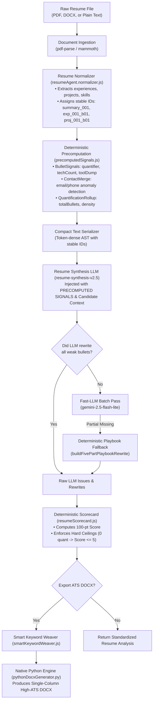
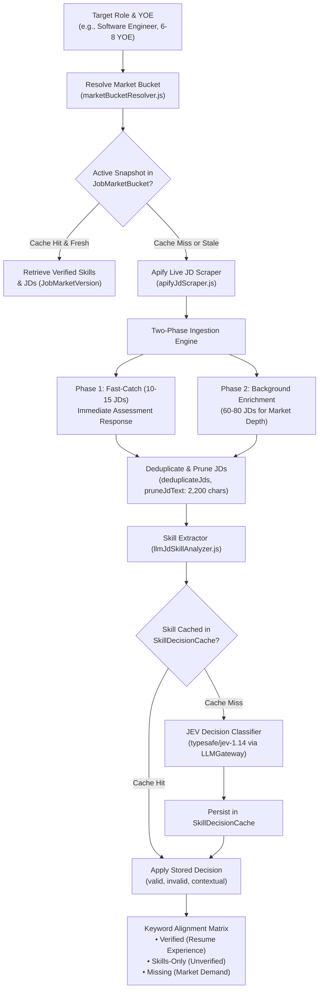
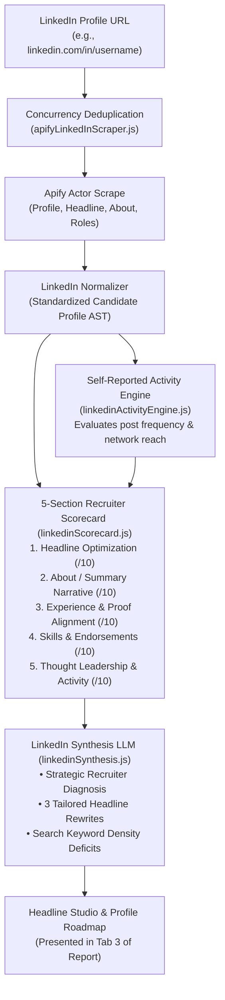
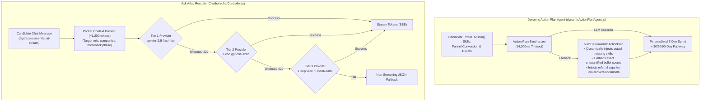
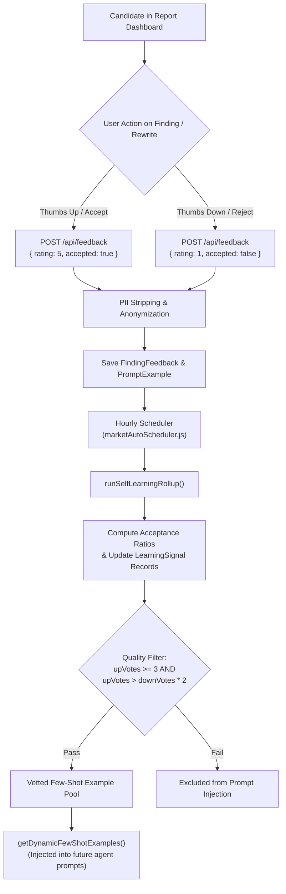

# Crafture Career GPS V2 — Multi-Agent Intelligence & Processing Pipelines

This document provides an in-depth specification of the specialized autonomous agents, deterministic signal layers, and data processing pipelines operating inside Crafture Career GPS V2.

---

## 1. Resume Agent (Mode C Hybrid Architecture)

The **Resume Specialist Agent** evaluates candidate resumes against target role benchmarks using a **Mode C Hybrid** design that couples deterministic pre-processing heuristics with an expert LLM synthesis pass and deterministic fallback playbooks.



### Deterministic Pre-Processing & Stable Identification
Resumes are normalized before prompt synthesis to prevent positional drift and hallucination:
- **Stable IDs**: Every bullet receives a deterministic ID based on role index and bullet sequence:
  - `exp_001_b01`, `exp_001_b02` (First experience entry, bullets 1 and 2)
  - `proj_001_b01` (First project entry, bullet 1)
  - `summary_001` (Professional summary)
- **Precomputed Signal Engine (`precomputedSignals.js`)**:
  - `BulletSignals`: Pre-tags every bullet with boolean flags (`hasQuantifier`, `technologyCount`, `hasOutcomeVerb`, `isToolDumpCandidate`).
  - `ContactMergeSignal`: Detects whether contact metadata (email, phone, URLs) is merged into the body text.
  - `QuantificationRollup`: Pre-calculates exact ratio of quantified bullets ($D = \frac{\text{quantified}}{\text{total}}$).

### Mandatory Signal Review & Synthesis Prompt (`resume-synthesis-v2.5`)
The single LLM synthesis prompt is constrained by strict rules:
- **Ground Truth**: The LLM treats `PRECOMPUTED SIGNALS` as ground truth and is forbidden from re-estimating numbers.
- **Tool-Dump Review**: Every bullet tagged with `isToolDumpCandidate: true` must either be surfaced as an issue or deliberately filtered.
- **Contact Merge Categorization**: Phrased as an observation of extracted text under category `ats_readability` (never claiming visual layout or columns without direct evidence).

### 5-Part Executive Formula Fallback
When the LLM omits rewrites, `buildFivePartPlaybookRewrite` in `backend/agents/resume/scoring/resumeScorecard.js` synthesizes a replacement adhering to the 5-Part Playbook:

$$\text{Rewrite} = \underbrace{\text{Action Verb}}_{\text{Part 1}} + \underbrace{\text{Core Task \& Scope}}_{\text{Part 2}} + \underbrace{\text{Stakeholders \& Methodology}}_{\text{Part 3}} + \underbrace{\text{Operational Metric}}_{\text{Part 4}} + \underbrace{\text{Business Outcome}}_{\text{Part 5}}$$

- **Compound Verb Stripping**: Cleans compound verbal openers (e.g., `"Automate and testing of..."` becomes `"Automated component testing..."`).
- **Domain-Matched Metric Pools**: Detects the bullet's domain from text keywords (`qa`, `frontend`, `backend`, `database`, `devops`, `security`, `ai`, `general`) to rotate contextually appropriate metrics (e.g. test coverage and defect leakage for QA; latency and throughput for backend; Lighthouse and accessibility for frontend).

### Deterministic Rubric Ceilings (`resumeScorecard.js`)
To prevent contradictory praise, the scorecard enforces hard ceilings on the candidate's Experience score:
- If `quantifiedBullets === 0`: `sectionAudit.experience.score10` is capped at $\le 5/10$ with status `warn` (`NEEDS POLISH`) and reason `"0 of N bullets (0%) contain measurable metrics"`.
- If `quantificationRate < 0.5`: Capped at $\le 7/10$ with status `warn`.
- Technology version numbers (e.g., `Java 17`, `Angular 14`, `WCAG 2.1`) and calendar years are explicitly stripped before evaluating metrics.

### Native Python ATS DOCX Generation
Exporting the ATS-optimized resume invokes `backend/services/docxResumeService.js`, which pipes canonical JSON and woven keywords into `backend/services/pythonDocxGenerator.py`. Built using `python-docx`, the generator produces clean, single-column documents with zero text boxes, tables, or parsing traps.

---

## 2. Market JD & JEV Skill Decision Cache

Career GPS aligns candidate skills against real-time live market demand using an automated scraping and classification pipeline.



### Two-Phase Scraping Protocol
1. **Phase 1: Fast-Catch (10–15 JDs)**: Fetches an initial snapshot of live postings within 3–5 seconds so the candidate's live assessment does not stall.
2. **Phase 2: Background Enrichment (60–80 JDs)**: Asynchronously ingests broader industry postings to populate comprehensive market frequencies.

### JEV Skill Classification (`jevDecisionClassifier.js`)
Extracted raw terms are passed through TypeSafe JEV (`typesafe/jev-1.14`) to eliminate noise and normalize skill taxonomy:
- **`valid`**: Genuine technical skills, tools, or frameworks (e.g., `PostgreSQL`, `Kubernetes`, `GraphQL`).
- **`invalid`**: Non-technical buzzwords or corporate filler (e.g., `fast learner`, `team player`, `results-driven`).
- **`contextual`**: Broad domain terms requiring explicit experience proof (e.g., `Agile`, `Leadership`).
All decisions are persisted in MongoDB under `SkillDecisionCache` to eliminate repeated LLM spend.

### Automated Hourly Scheduler (`marketAutoScheduler.js`)
A background cron job runs hourly to:
- Identify stale market buckets ($> 7$ days old).
- Trigger background Apify scrapes.
- Execute `runSelfLearningRollup()` to consolidate feedback metrics.

---

## 3. LinkedIn Recruiter Visibility Agent

The LinkedIn Specialist Agent evaluates a candidate's profile through the eyes of an executive technical recruiter looking for inbound search visibility and domain credibility.



### Note on Deprecated Public Post Scraping
In Career GPS V1, the agent attempted to scrape public post feeds via Apify actors. In production, this led to frequent rate limits, CAPTCHA blocks, and high failure rates. In V2, **live post scraping is officially deprecated** in favor of candidate self-reported activity signals collected during assessment onboarding and audited deterministically by `linkedinActivityEngine.js`.

### 5-Section Recruiter Rubric
Every profile is scored on a standardized 10-point scale across 5 dimensions:
1. **Headline Optimization**: Keyword density, target role specialization, and proof of domain authority.
2. **About / Summary Narrative**: Narrative arc, technical positioning, and elimination of first-person filler.
3. **Experience & Proof Alignment**: Consistency with resume claims and presence of verifiable achievements.
4. **Skills & Endorsements**: Alignment between top 3 pinned skills and target role job market requirements.
5. **Thought Leadership & Activity**: Engagement frequency and platform visibility to recruiter search algorithms.

### Headline Studio Rewrites
The agent synthesizes three distinct, ready-to-paste headline archetypes:
- **Role Specialist**: Targeted at corporate ATS and recruiters searching for exact keywords.
- **High-Growth Operator**: Focused on scale, metrics, and business outcomes.
- **Technical Architect**: Highlights architectural depth, distributed systems, or specialized domain engineering.

---

## 4. Dynamic Action Plan & Ask Atlas Chatbot



### Dynamic Action Plan Features
- **High-Volume / Low-Callback Guard**: Candidates submitting $\ge 100$ applications with $\le 1.0\%$ callback rates (e.g. 2,000 applications yielding 2 screens) receive explicit mandates in Day 5 and the 30-Day Milestone to halt mass untargeted applications and cap outreach at **15 targeted referrals/week**.
- **Real Missing Skills**: Injects verified market missing skills (e.g. AWS, Kafka, Terraform) directly into Day 1 ATS alignment.
- **Dynamic Recruiter Search Strings**: Produces custom LinkedIn Boolean queries matching candidate tools and target titles:
  ```text
  ("Engineering Manager" OR "Director of Engineering" OR "VP of Engineering") AND ("Software Engineer") AND ("React" OR "Node.js")
  ```

### Ask Atlas Chatbot
- **Context Grounding**: Every prompt is prefixed with a concise ~1,200-token Pocket Dossier containing candidate profile coordinates, primary hiring bottleneck, and top bullet findings.
- **Token Streaming**: Delivers sub-second initial token latency over Server-Sent Events (`/api/assessment/chat-stream`).
- **Resilient Fallback**: 3-tier provider failover ensures conversational continuity even during major AI API outages.

---

## 5. Self-Learning Feedback Loop

Career GPS improves its bullet rewrites and diagnostic accuracy over time using candidate feedback.



### Continuous Quality Improvement
1. **Feedback Collection (`POST /api/feedback`)**: Records rating, category, candidate target role, original bullet, and rewritten bullet.
2. **PII Stripping**: Normalizes role keys (`software-engineer`, `product-manager`), strips candidate names, company references, and personal data.
3. **Statistical Rollup (`runSelfLearningRollup`)**: Runs hourly to calculate acceptance ratios and update `LearningSignal` documents.
4. **Few-Shot Prompt Injection (`getDynamicFewShotExamples`)**: Only examples with strong community validation ($\ge 3$ upvotes and $\text{upvotes} > 2 \times \text{downvotes}$) are injected as few-shot demonstrations into live agent synthesis prompts.
