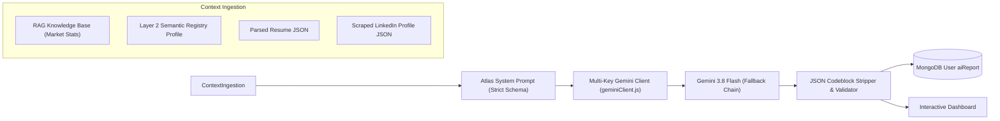

# AI Pipeline & Intelligence Engine

The Crafture Career GPS AI pipeline delivers deep, personalized executive diagnostics without robotic filler or generic platitudes.

---

## 1. The "Atlas" Persona & Tone Architecture

All report evaluations are generated under the **"Atlas"** persona:

- **Title**: Elite $2,000/hour Executive Career Strategist, Senior Technical Recruiter, and ATS Systems Expert.
- **Track Record**: 500+ successful placements into FAANG, Fortune 500, and hyper-growth startups.
- **Voice Guidelines**:
  - Direct, honest, empathetic, and urgent ("Survival Mode" coaching).
  - Explicit prohibition of AI filler words (e.g. _"In conclusion"_, _"It is crucial to"_, _"Navigating the job market"_, _"Delve"_).
  - Speaks directly to the candidate, citing real numbers, specific technologies, and actual gap durations.

---

## 2. Gemini 3.8 Flash Integration & Multi-Key Fallback (`geminiClient.js`)

Reports and resume extractions are powered by Google's **`gemini-3.6-flash`** model with automatic multi-API-key pool rotation and multi-model fallback (`gemini-3.6-flash` → `gemini-3.6-flash` → `gemini-2.0-flash` → `gemini-1.5-flash`):



### Safety & Escaping Mechanisms

User input can contain quotes, backticks, or special characters (e.g. within code interview anecdotes or roadblock narratives). The pipeline utilizes `safeJson`:

```javascript
const safeJson = (data) => {
  if (!data) return "";
  return JSON.stringify(data, null, 2).replace(/`/g, "'");
};
```

This guarantees that template literal evaluation in Node.js cannot be compromised or broken.

---

## 3. Resume Multi-Modal Document Parsing

When a candidate uploads a resume file (`.pdf`, `.docx`):

1. **Buffer Ingestion**: Multer captures the file buffer in memory without writing temporary files to disk.
2. **Inline Data Transmission**:
   ```javascript
   const filePart = {
     inlineData: {
       data: fileBuffer.toString("base64"),
       mimeType: mimeType || "application/pdf",
     },
   };
   ```
3. **Structured Extraction**: Gemini converts the document into an ATS Audit object:
   - `candidate_name`, `target_role`, `years_of_experience`
   - `top_skills`, `missing_ats_keywords`, `ats_score`
   - `strengths` (with quantitative evidence)
   - `red_flags` (unexplained gaps, formatting traps, missing metrics)
   - `executive_ai_critique` (3-4 sentence punchy evaluation)

---

## 4. Cookieless LinkedIn Scraping (`apifyLinkedInScraper.js`)

To evaluate digital visibility without requesting candidate LinkedIn credentials:

- Uses the Apify Actor: `harvestapi/linkedin-profile-scraper`.
- Input: The public URL submitted in Step 11 (`linkedin`).
- Extracted Fields:
  - Full headline and about summary
  - Follower count and connection bracket (e.g. 500+)
  - Current employer, location, and featured projects
- Graceful Degradation: If a candidate has set their profile to completely private or if scraping encounters an Apify rate limit, the pipeline falls back seamlessly and notes the private status in the report.

---

## 5. RAG Knowledge Base Engine (`ragEngine.js`)

To prevent hallucination of salary bands, hiring market trends, and visa compliance policies, the platform employs a dynamic Retrieval-Augmented Generation (RAG) engine:

1. **Smart Query Construction**:
   `buildSmartQuery(answers, resumeJson)` analyzes candidate role (e.g. _Full Stack Engineer_), visa status (e.g. _STEM OPT_), and key challenges to create a targeted search vector.
2. **Multi-Source Context Assembly**:
   - Merges core baseline career intelligence (`backend/utils/knowledgeBase.js`) with active administrative documents stored in MongoDB (`KBDocument`).
3. **Priority Hierarchy**:
   The prompt explicitly commands Gemini:
   > _"You have been provided with a verified Knowledge Base. You MUST base your facts, statistics, and strategies PRIMARILY on this data. Do NOT contradict it."_
