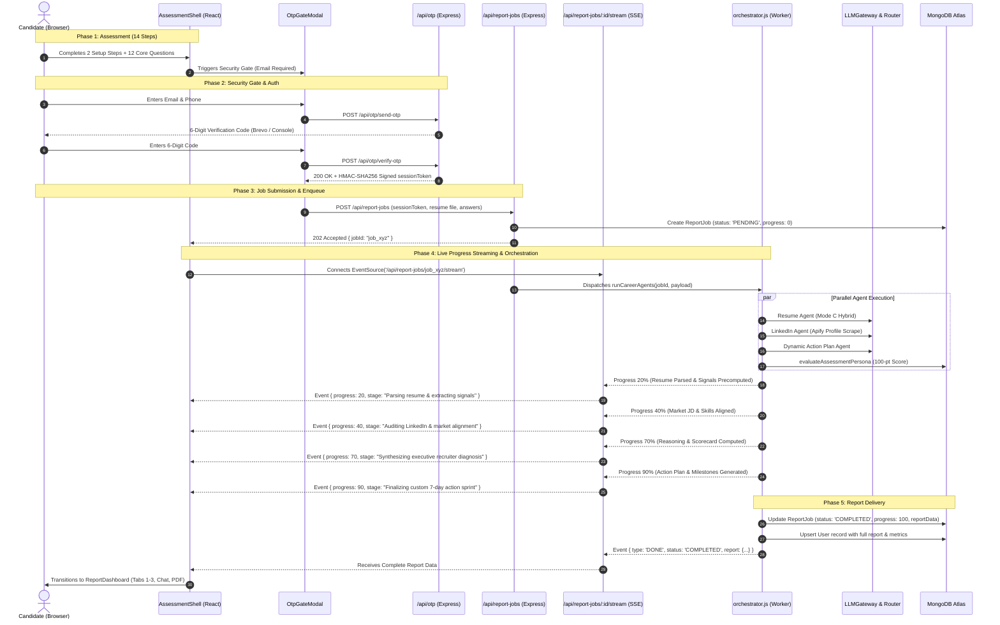
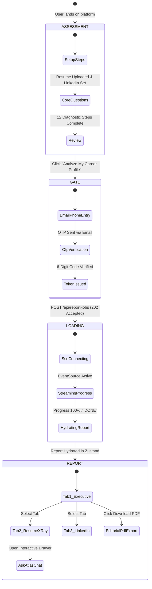
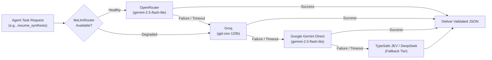
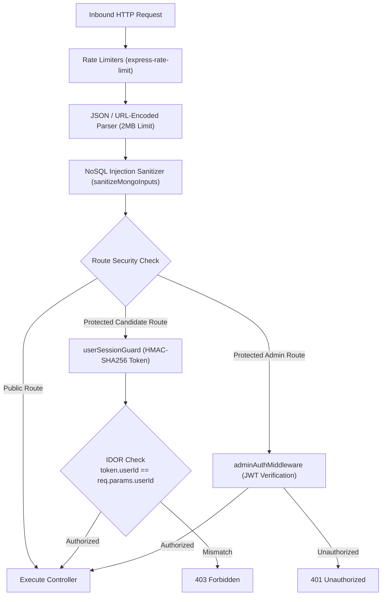

# Crafture Career GPS V2 — Architecture & System Lifecycle

This document provides a comprehensive technical overview of the Crafture Career GPS V2 platform architecture, including the end-to-end request lifecycle, real-time SSE streaming protocol, frontend state machine, multi-provider AI Gateway with circuit breaking, security specifications, and codebase structure.

---

## 1. End-to-End Request & SSE Report Lifecycle

The platform uses an asynchronous, non-blocking pipeline for generating deep career assessments. Because high-resolution multi-agent evaluation (resume parsing, deterministic signal extraction, market JD matching, LinkedIn auditing, and dynamic action planning) requires 10–25 seconds of compute, Career GPS decouples request acceptance from processing via background jobs and Server-Sent Events (SSE).



---

## 2. Frontend State Machine & Architecture

The frontend client manages candidate state via a reactive 4-phase state machine implemented in Zustand (`src/store/useAppStore.js`).



### Key Frontend Components

- **`AssessmentShell.jsx`**: Manages step navigation, progress tracking, and validation across all 14 steps.
- **`StepRenderer.jsx`**: Renders custom UI controls per question (quantitative sliders, pill selects, multi-toggles, and timeframes).
- **`OtpGateModal.jsx`**: Enforces email/phone collection, triggers OTP dispatch, and verifies candidate identity before report processing.
- **`AnalysisLoader.jsx`**: Connects to the SSE stream, renders stage-by-stage progress feedback, and displays interactive curiosity cards during processing.
- **`ReportDashboard.jsx`**: The unified executive reporting view containing:
  - **Tab 1 (Executive Summary & Funnel)**: `ReportHero`, `PrimaryBottleneck`, `FunnelAndConversionSection`, `RoadmapTimeline`, `FinalNextAction`.
  - **Tab 2 (Resume Deep Diagnosis)**: `ResumeScoreCard`, `ResumeDeepDiagnosis`, `ResumeBulletAudit`, `compare-bars`.
  - **Tab 3 (LinkedIn Recruiter Intelligence)**: `LinkedInDeepDiagnosis`, `LinkedInHeadlineStudio`, `RiskHeatMap`.
- **`CareerReportPdf.jsx`**: Editorial multi-page PDF generation engine using `@react-pdf/renderer` with seamless edge-mask illustration banners and strict scoring rubric ceilings.
- **`AskAtlasDrawer.jsx`**: Interactive recruiter career advisor chatbot with streaming token response and context dossier grounding.

---

## 3. AI Gateway & Circuit Breaker Architecture

All AI inference across Career GPS routes through the custom enterprise **AI Gateway** located in `backend/ai/gateway/llmGateway.js` and `backend/ai/gateway/liteLlmRouter.js`.

### Circuit Breaker States & Transitions

The circuit breaker prevents cascade failures, 429 quota exhaustion, and slow timeouts (e.g., waiting 60 seconds on degraded third-party providers) by isolating failing providers.

```mermaid
stateDiagram-v2
    [*] --> CLOSED: Initial System Startup

    state CLOSED {
        description: Normal Operation. All requests routed to primary provider.
    }

    CLOSED --> OPEN: >= 2 Consecutive Failures OR 503/502/Timeout
    
    state OPEN {
        description: Provider Degraded. Requests immediately fast-failover to backup candidate.
    }

    OPEN --> HALF_OPEN: Cooldown Elapsed (45,000ms)
    
    state HALF_OPEN {
        description: Canary Mode. Dispatches 1 probe request to test provider recovery.
    }

    HALF_OPEN --> CLOSED: Canary Request Succeeds
    HALF_OPEN --> OPEN: Canary Request Fails (Reset Cooldown)
```

### Provider Fallback Chain

When an agent initiates a task, `llmGateway` resolves the prioritized provider chain:



### Task-to-Model Routing (`TASK_MODEL_ROUTING`)

Specific tasks are routed to calibrated models to optimize token economics and latency:

| Task Key | Primary Model | Provider | Context & Reasoning |
| :--- | :--- | :--- | :--- |
| `resume_synthesis` | `google/gemini-2.5-flash-lite` | OpenRouter / Groq | Primary resume audit, issues, and executive summary |
| `bullet_rewrites` | `google/gemini-2.5-flash-lite` | OpenRouter / Groq | Fast batch bullet rewrites using Google XYZ syntax |
| `linkedin_synthesis` | `google/gemini-2.5-flash-lite` | OpenRouter / Groq | 5-section LinkedIn audit and headline generation |
| `report_generation` | `google/gemini-2.5-flash-lite` | OpenRouter / Groq | Executive diagnostic copy and bottleneck summary |
| `jev_decision` | `typesafe/jev-1.14` | JEV / OpenRouter | Deterministic market skill classification |
| `bullet_triage_decision` | `typesafe/jev-1.14` | JEV / OpenRouter | Classifies bullet proof level (`strong`, `adequate`, `weak`) |

### Trap Model Filtering (`TRAP_MODELS`)

The gateway explicitly bans known failure-prone or rate-limited models:
```javascript
export const TRAP_MODELS = new Set([
  'gemini-2.5-flash',       // Chronic 429 quota exhaustion in production
  'gemini-2.0-flash',       // Legacy version deprecations
  'gemini-1.5-flash',       // Sub-tier reasoning on complex resume ASTs
  'gemini-1.5-pro',         // High latency (25s+) exceeding SSE timeout budgets
])
```

### Telemetry & Cost Tracking

- **`costTracker.js`**: Calculates exact USD expenditure per provider call using prompt and completion token counts.
- **`llmCache.js`**: Exact-hash caching for repeated identical candidate inputs, yielding 0ms latency and $0.00 cost.
- **`aiTelemetry.js`**: Aggregates latency, provider fallbacks, and error rates exposed via the Admin dashboard.

---

## 4. Security & Hardening Architecture

Career GPS processes sensitive candidate career data and resumes. The backend employs strict security controls:



### 1. Cryptographic Candidate Sessions (`userAuth.js`)
- Tokens are signed with `HMAC-SHA256` using `SESSION_SECRET` with an embedded payload `{ userId, email, exp }`.
- Valid for 30 days. Protects candidate data without requiring cumbersome passwords.
- **IDOR Protection**: Enforces that the `userId` in the session token matches the target document/report parameter.

### 2. Admin Authentication (`adminAuth.js`)
- Signed JSON Web Tokens (JWT) verified against `JWT_SECRET`.
- Admin endpoints reject missing, expired, or malformed tokens with `401 Unauthorized`.

### 3. NoSQL Injection Prevention
- Middleware runs regex sanitization across `req.body`, `req.query`, and `req.params`.
- Strips any keys containing leading `$` (MongoDB operators like `$gt`, `$ne`, `$where`) and embedded `.` characters.

### 4. Granular Rate Limiting
Configured via `express-rate-limit`:
- **`aiLimiter`**: 15 requests per 15 minutes on AI trigger endpoints (`POST /api/assessment`, `POST /api/report-jobs`, `POST /api/resume-agent`). **GET polling requests are explicitly bypassed** to prevent SSE and status check timeouts.
- **`sendLimiter`**: 3 OTP dispatches per 10 minutes per IP/email.
- **`verifyLimiter`**: 5 verification attempts per 10 minutes.
- **`feedbackLimiter`**: 30 feedback submissions per 15 minutes.

### 5. Memory & Payload Protection
- `express.json({ limit: '2mb' })` and `express.urlencoded({ limit: '2mb', extended: true })`.
- File uploads restricted to PDF, DOCX, and TXT up to 10MB via `multer`.

---

## 5. Codebase Directory Map

```text
carrer-gps-asessment/
├── backend/                               # Node.js/Express Backend
│   ├── agents/                            # Multi-Agent Intelligence Core
│   │   ├── core/                          # Structured JSON output parser
│   │   ├── linkedin/                      # LinkedIn Agent & Activity Engine
│   │   ├── resume/                        # Resume Specialist Agent (Mode C Hybrid)
│   │   │   ├── facts/                     # Deterministic fact normalization
│   │   │   ├── market/                    # JD analyzers, clustering, & JEV
│   │   │   ├── orchestration/             # Mode C Hybrid orchestration & fallbacks
│   │   │   ├── parser/                    # PDF/DOCX parser & normalizer
│   │   │   ├── scoring/                   # Resume scorecard & deterministic rubrics
│   │   │   ├── signals/                   # Precomputed signals (quant, contact, dump)
│   │   │   └── synthesis/                 # Prompt builders & synthesis runner
│   │   └── orchestrator.js                # Parallel multi-agent pipeline coordinator
│   ├── ai/                                # Enterprise AI Gateway Layer
│   │   ├── cache/                         # Deterministic LLM response cache
│   │   ├── config/                        # Model registry & configuration
│   │   ├── gateway/                       # LLMGateway & liteLlmRouter circuit breaker
│   │   └── telemetry/                     # Quota & latency tracking
│   ├── controllers/                       # Express Route Controllers
│   │   ├── assessmentController.js        # Answer saving & report retrieval
│   │   ├── chatController.js              # Ask Atlas streaming chatbot
│   │   └── otpController.js               # Brevo email & OTP verification
│   ├── integrations/                      # Third-party platform connectors
│   │   └── apify/                         # Apify LinkedIn & JD scrapers
│   ├── jobs/                              # Scheduled background tasks
│   │   └── marketJd/                      # Hourly market cache scheduler
│   ├── models/                            # Mongoose Schema Definitions (11 models)
│   ├── routes/                            # Express Endpoint Groupings (8 groups)
│   ├── services/                          # Core backend support services
│   │   ├── docxResumeService.js           # ATS resume DOCX service
│   │   ├── dynamicActionPlanAgent.js      # Dynamic 7-Day & 30/60/90d action plan
│   │   ├── promptExampleService.js        # Self-learning dynamic prompt injection
│   │   ├── pythonDocxGenerator.py         # Native Python python-docx builder
│   │   └── reportGeneration.js            # Unified report synthesizer
│   ├── utils/                             # Utilities, Auth Guards, & Helpers
│   └── server.js                          # Express application entrypoint
├── docs/                                  # Architectural & Technical Documentation
│   ├── AGENTS_AND_PIPELINES.md            # Multi-agent pipelines deep-dive
│   ├── API_AND_MODELS.md                  # Complete API routes & Mongoose models
│   └── ARCHITECTURE.md                    # System architecture & lifecycle (This file)
├── src/                                   # Frontend Client (React 19 + Vite 8)
│   ├── assets/                            # Brand assets, Mascot, & Editorial images
│   ├── components/                        # React UI Components
│   │   ├── assessment/                    # AssessmentShell & StepRenderer (14 steps)
│   │   ├── chat/                          # Ask Atlas interactive drawer
│   │   ├── gate/                          # OtpGateModal security gate
│   │   ├── loading/                       # AnalysisLoader live SSE progression
│   │   ├── pdf/                           # CareerReportPdf (@react-pdf/renderer)
│   │   ├── report/                        # Executive report cards, tabs, & charts
│   │   └── ui/                            # Atoms (QuantitativeInput, Buttons, Cards)
│   ├── lib/                               # Client libraries & assessment definitions
│   │   ├── api.js                         # Axios client & payload normalizer
│   │   └── assessmentSteps.js             # 14 assessment steps & SEMANTIC_REGISTRY
│   ├── store/                             # Zustand State Management
│   │   └── useAppStore.js                 # Global candidate & report state store
│   ├── App.jsx                            # Root application & phase router
│   ├── index.css                          # Tailwind CSS v4 & theme variables
│   └── main.jsx                           # React DOM mount point
├── DESIGN.md                              # V2 Design System & Editorial PDF rules
├── package.json                           # Root dependencies & scripts
└── README.md                              # Main project overview & quickstart
```
