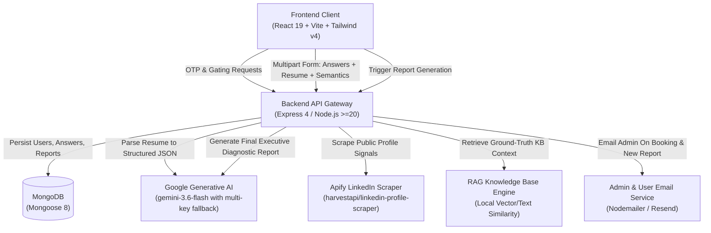
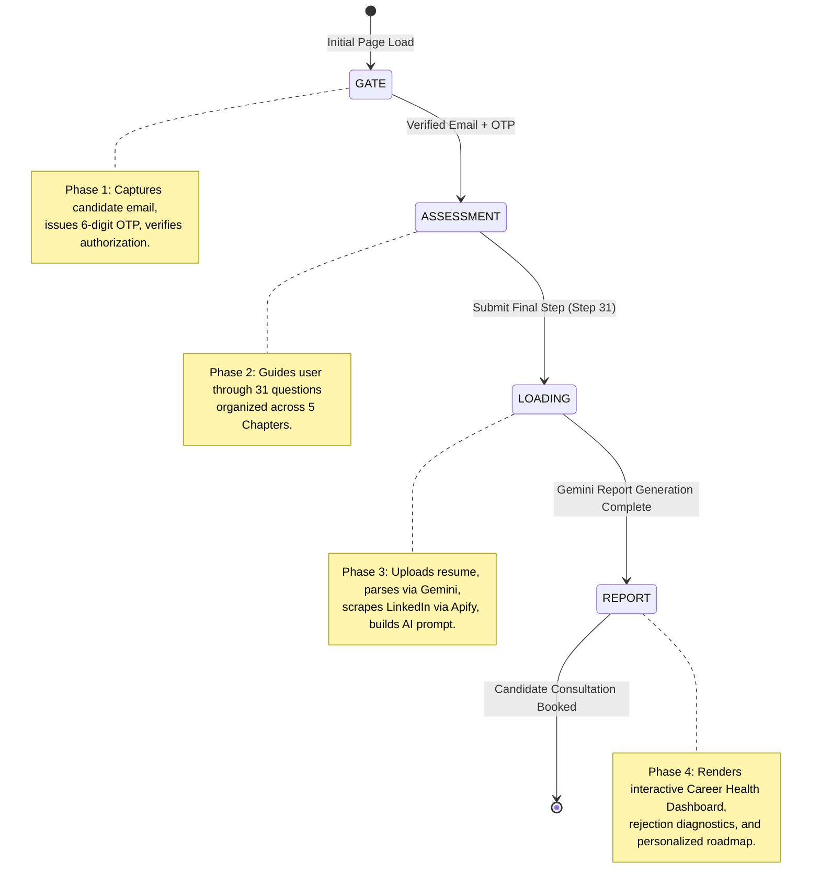
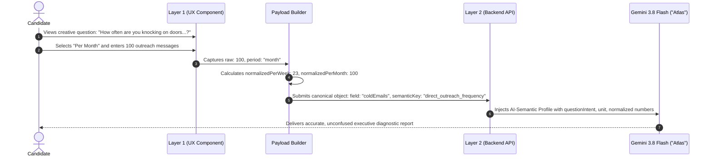

# Architecture Guide — Crafture Career GPS

This document outlines the system architecture, component boundaries, state flow, and data lifecycles of the **Crafture Career GPS** application.

---

## 1. High-Level System Architecture

Crafture Career GPS is built as a distributed, decoupled client-server web application optimized for ultra-fast load times, seamless user onboarding, and deep AI-driven analysis.

---

## 2. Frontend Lifecycle & State Machine

The client application is orchestrated through **Zustand** (`src/store/useAppStore.js`) across **4 primary phases** and one dedicated unlinked administrative route:

### Application Phases Definition (`PHASES` enum)

| Phase Constant                       | UI Component          | Responsibility                                                                                                                                   |
| :----------------------------------- | :-------------------- | :----------------------------------------------------------------------------------------------------------------------------------------------- |
| `PHASES.GATE` (`'gate'`)             | `GatePhase.jsx`       | Dual-step email entry (`EmailStep`) followed by 6-digit one-time password confirmation (`OTPStep`). Populates `userId` and `userEmail` in store. |
| `PHASES.ASSESSMENT` (`'assessment'`) | `AssessmentShell.jsx` | 31-step wizard renderer. Manages current step index, progress bar, chapter headers, form values, and quick-fill demo buttons.                    |
| `PHASES.LOADING` (`'loading'`)       | `AnalysisLoader.jsx`  | Full-screen animated radar sequence. Dispatches `api.generateReport`, polls progress messages, and catches backend errors.                       |
| `PHASES.REPORT` (`'report'`)         | `ReportDashboard.jsx` | Complete executive dashboard with GSAP reveal animations, radar charts, risk heatmap, action items, and booking CTA.                             |

### Administrative Route

- Navigating to `/admin/knowledge-base`, `/knowledge-base`, `/admin/kb`, or `/kb` directly displays the **KnowledgeBaseManager** component (`src/components/admin/KnowledgeBaseManager.jsx`), allowing administrators to upload, view, search, and delete knowledge base files utilized by the RAG engine.

---

## 3. The Dual-Layer Assessment Architecture

The core innovation of Crafture Career GPS is the separation of **Layer 1 (Candidate Experience)** from **Layer 2 (AI Semantic Interpretation)**:

### Layer 1: Conversational Visual Experience

- Uses curiosity-driven, friendly phrasing instead of dry corporate questionnaires.
- Every step features contextual helper text, custom iconography, and thematic scene titles (e.g. _U.S. Work Authorization Checkpoint_, _Proactive Direct Outreach_).
- Quantitative inputs provide a dynamic `[ 📅 Per Week ]` / `[ 🗓️ Per Month ]` switcher with live conversion feedback and one-click presets.

### Layer 2: Machine-Readable AI Semantic Registry

- Grounded in `SEMANTIC_REGISTRY` in [`src/lib/assessmentSteps.js`](../src/lib/assessmentSteps.js).
- For every question, the AI receives:
  - `field`: The canonical database identifier (`coldEmails`, `appsWeek`, `visa`, etc.).
  - `semanticKey`: The business-logic definition (`direct_outreach_frequency`, `job_application_volume`).
  - `questionIntent`: Explicit explanation of what the question measures and why.
  - `answerType`: Category type (`frequency`, `count`, `boolean`, `category`, `document_file`, `multi_select`).
  - `unit` & `timeframe`: Dimensional metrics (e.g. `messages`, `weekly_or_monthly`).
  - `normalizedPerWeek` & `normalizedPerMonth`: Pre-calculated metrics to eliminate AI arithmetic errors.
  - `interpretationRules`: Industry benchmarks guiding score calculation.

---

## 4. Backend Processing Pipeline

When the assessment is completed, the backend processes the data through a 5-stage pipeline:

1. **Answer & Document Ingestion** (`saveAnswers` in `assessmentController.js`):
   - Accepts multipart/form-data with resume file and JSON stringified `answers` & `semanticProfile`.
   - Validates user identity and email verification status.
2. **Resume Multi-Modal Parsing** (`parseResumeToJSON`):
   - Streams PDF or Word file buffer to `gemini-3.6-flash` via `geminiClient.js` with multi-key failover.
   - Returns structured JSON containing candidate name, skills, ATS keyword gaps, quantitative evidence, and executive critique.
3. **LinkedIn Intelligence Extraction** (`scrapeLinkedInProfile` in `apifyLinkedInScraper.js`):
   - Uses Apify Actor `harvestapi/linkedin-profile-scraper` without storing sensitive cookies.
   - Extracts current role, headline, connection count, and public profile summary.
4. **Dynamic RAG Context Assembly** (`buildRAGContext` in `ragEngine.js`):
   - Constructs a synthesized semantic query based on candidate target role, visa type, and resume keywords.
   - Retrieves ground-truth career statistics from baseline knowledge and active uploaded documents.
5. **Executive Report Generation** (`getGeminiPrompt` in `geminiPrompt.js`):
   - Invokes `gemini-3.6-flash` (with automated fallback chain) under the authoritative "Atlas" persona.
   - Enforces a strict JSON contract for the 10+ report sections.
   - Automatically stores the generated report in MongoDB on the `User` model and fires an administrative notification email.
